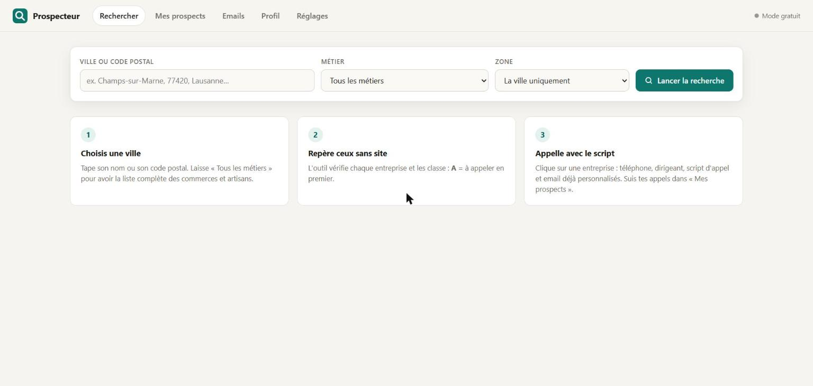

# Prospecteur

Outil local de **prospection commerciale** pour un créateur de sites web indépendant. Il trouve les commerces et artisans d'une ville qui **n'ont pas de site internet**, les classe par priorité, prépare les appels et suit chaque prospect jusqu'au rendez-vous.

Projet personnel développé en JavaScript (Node.js) avec l'IA générative (Claude Code), et qui utilise l'API Claude.



## Ce que fait l'outil

- **Recherche par ville et par métier**, en croisant 4 sources et en fusionnant les doublons (nom proche au même endroit, ou même téléphone) :
  - le registre officiel des entreprises (SIRENE) : nom, adresse, dirigeant, date de création ;
  - OpenStreetMap : vitrines, téléphones, sites connus ;
  - Google Maps (facultatif, avec une clé) : téléphone, note, avis, site déclaré, avec un compteur qui s'arrête avant le quota gratuit ;
  - une détection automatique qui teste les sites au nom de l'entreprise.
- **Priorité A / B / C** expliquée pour chaque prospect, avec un niveau de confiance selon le nombre de sources qui concordent. Les franchises sont écartées.
- **Appel guidé** : un arbre de conversation personnalisé (nom, dirigeant, avis, ancienneté), avec une réponse prête pour chaque objection courante. Gratuit, sans IA.
- **Script IA** (facultatif) : l'API Claude rédige un script d'appel sur mesure à partir de la fiche, avec la consigne de ne rien inventer. Le coût de chaque génération est affiché et un plafond mensuel bloque l'outil s'il est atteint.
- **E-mails de prospection** : séquences de 3 messages (premier e-mail, relance à 4 jours, dernier message à 7 jours). L'outil propose une création de site, ou une refonte seulement s'il a relevé un défaut vérifiable sur le site existant.
- **Suivi** : statuts, historique des appels, qualification, relances, notifications Windows avant les rendez-vous, export Excel.

## Choix de conception

- **Tout reste sur l'ordinateur** : le serveur tourne en local, les données sont dans un dossier `donnees/` qui n'est pas dans ce dépôt.
- **Envoi d'e-mails prudent** : texte simple sans lien ni mouchard, un e-mail par minute au plus, aux heures de bureau, montée progressive du volume quotidien, liste « Ne plus contacter » toujours respectée, et chaque e-mail indique d'où vient l'adresse.
- **Pas d'invention** : un e-mail qui contient encore un champ à compléter est refusé, et les avis clients cités doivent être réels.

## Lancer le projet

Il faut [Node.js](https://nodejs.org).

```bash
npm install
node serveur.mjs
```

L'outil s'ouvre sur http://localhost:4321. Sous Windows, `LANCER.bat` le démarre en arrière-plan.

Le mode d'emploi complet (en français) est dans [LISEZ-MOI.md](LISEZ-MOI.md).

## Limites

- Le registre SIRENE est français : hors de France, l'outil se limite à OpenStreetMap et Google Maps.
- Sans clé Google, la mention « aucun site trouvé » reste une estimation à vérifier.
- Les règles du démarchage changent selon les pays : à vérifier avant d'appeler ou d'écrire.

## Auteur

Gabriel Richet, étudiant en Bachelor Numérique et Management à l'ESIEE Paris. [LinkedIn](https://www.linkedin.com/in/gabriel-richet9/)
